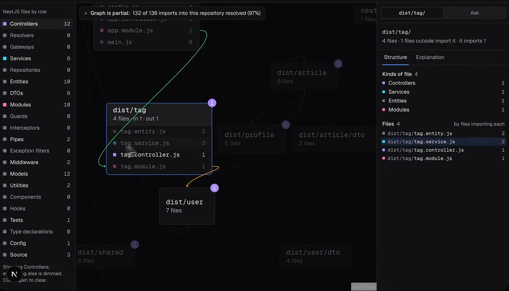
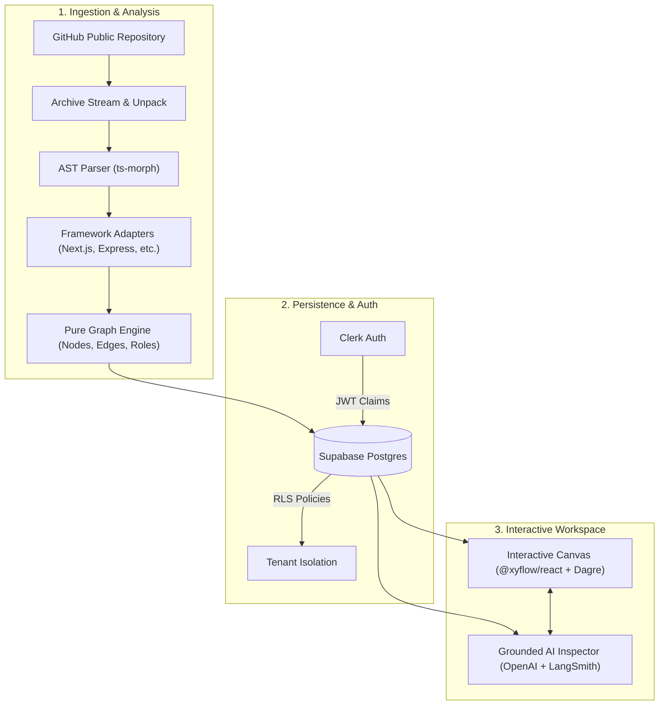

<div align="center">
 


                                                            
      ██████╗ ██╗    ██╗███╗   ██╗     ██╗████████╗           
     ██╔═══██╗██║    ██║████╗  ██║     ██║╚══██╔══╝            
     ██║   ██║██║ █╗ ██║██╔██╗ ██║     ██║   ██║               
     ██║   ██║██║███╗██║██║╚██╗██║     ██║   ██║               
     ╚██████╔╝╚███╔███╔╝██║ ╚████║     ██║   ██║               
      ╚═════╝  ╚══╝╚══╝ ╚═╝  ╚═══╝     ╚═╝   ╚═╝               
                                                             
           


  <p align="center">
   
    <i>Transform complex, unfamiliar repositories into interactive, mathematically verified dependency graphs and context-grounded architectural intelligence.</i>
  </p>

  <p align="center">
    <a href="#-key-features">Features</a> •
    <a href="#-system-architecture">Architecture</a> •
    <a href="#-tech-stack">Tech Stack</a> •
    <a href="#-getting-started">Getting Started</a> •
    <a href="#-cli-tools">CLI & Pipeline</a> •
    <a href="#-roadmap">Roadmap</a>
  </p>

  <div>
    
    
    
    
    
    
    
  </div>
</div>

---

## 🧭 Overview

Modern software engineering teams frequently onboard into massive codebases, integrate third-party packages, or ship AI-generated components without full visibility into downstream side-effects. This leads to hidden dependency coupling, architectural decay, and fragile refactors.

**Own It** solves this by strictly parsing raw source code into deterministic Abstract Syntax Tree (AST) nodes and dependency edges. 

> **Core Principle: Deterministic Structure Over LLM Hallucinations**  
> Every node, edge, and import on the canvas is derived strictly through the TypeScript Compiler API (`ts-morph`) and graph arithmetic—never from AI guesses. AI agents are utilized solely to summarize, explain, and contextualize verified structure.

---

## ⚡ Key Features

- **AST-Powered Dependency Extraction**: Parses imports, re-exports, dynamic imports, and `require()` calls deterministically using `ts-morph`.
- **Interactive Architecture Canvas**: High-performance pan, zoom, expand, and cluster inspection powered by `@xyflow/react` and Directed Acyclic Graph (DAG) layout via `dagre`.
- **Blast Radius Analysis**: Instant graph arithmetic calculating every upstream dependent and downstream consumer affected when modifying a specific file or module.
- **Grounded AI Architectural Assistant**: Explains file roles and module relationships with strict provenance—every cited file is linked directly to an active canvas node.
- **Multi-Tenant Workspaces**: Multi-organization repository analysis with role-based access control driven by Clerk organizations.
- **Strict Row-Level Security (RLS)**: Enforced directly at the Postgres layer via Supabase, evaluating tenant isolation from cryptographically verified JWT claims.
- **Full Observability & Caching**: Traced with LangSmith to monitor token usage, LLM execution latency, cache hits, and response ground-truth alignment.

---

## 🏗️ System Architecture



---

## 🛠️ Tech Stack

| Layer | Technology | Purpose |
| :--- | :--- | :--- |
| **Framework** | [Next.js 16](https://nextjs.org/) (App Router, Server Actions) | Full-stack server components and streaming pipeline |
| **Frontend** | [React 19](https://react.dev/), [Tailwind CSS v4](https://tailwindcss.com/) | High-density developer UI with dark/light theme tokens |
| **Visualization** | [React Flow (@xyflow/react)](https://reactflow.dev/), [@dagrejs/dagre](https://github.com/dagrejs/dagre) | Interactive canvas graph rendering and hierarchical auto-layout |
| **Code Parser** | [ts-morph](https://ts-morph.com/) (TypeScript Compiler API) | Deterministic AST parsing and symbol resolution |
| **Database** | [Supabase](https://supabase.com/) (PostgreSQL) | Pipeline state tracking, graph caching, and Row-Level Security |
| **Authentication** | [Clerk](https://clerk.com/) | Multi-tenant user and organization management |
| **AI Intelligence** | [OpenAI API](https://platform.openai.com/) | Context-grounded codebase summaries and architectural insights |
| **Observability** | [LangSmith](https://smith.langchain.com/) | LLM trace tracking, cache verification, and latency metrics |
| **Package Manager** | [pnpm](https://pnpm.io/) | Fast, disk space-efficient dependency management |

---

## 🚀 Getting Started

### Prerequisites

Ensure you have the following installed:
- [Node.js](https://nodejs.org/) (v20+ recommended)
- [pnpm](https://pnpm.io/) (v9+)
- [Git](https://git-scm.com/)

### 1. Clone the Repository

```bash
git clone https://github.com/mo171/cartograph.git
cd cartograph
```

### 2. Install Dependencies

```bash
pnpm install
```

### 3. Configure Environment Variables

Create a `.env.local` file in the root of your project:

```bash
cp .env.example .env.local
```

Fill in your configuration credentials:

```env
# CLERK AUTHENTICATION
NEXT_PUBLIC_CLERK_SIGN_IN_URL=/sign-in
NEXT_PUBLIC_CLERK_SIGN_UP_URL=/sign-up
NEXT_PUBLIC_CLERK_SIGN_IN_FALLBACK_REDIRECT_URL=/
NEXT_PUBLIC_CLERK_SIGN_UP_FALLBACK_REDIRECT_URL=/
NEXT_PUBLIC_CLERK_PUBLISHABLE_KEY=pk_test_...
CLERK_SECRET_KEY=sk_test_...

# SUPABASE POSTGRES
NEXT_PUBLIC_SUPABASE_URL=https://<your-project>.supabase.co
NEXT_PUBLIC_SUPABASE_PUBLISHABLE_KEY=eyJ...
SUPABASE_SECRET_KEY=eyJ...

# LANGSMITH TRACING (Optional for local dev)
LANGSMITH_TRACING=true
LANGSMITH_API_KEY=lsv2_pt_...
LANGSMITH_PROJECT=own-it
LANGSMITH_ENDPOINT=https://api.smith.langchain.com

# OPENAI AI INTELLIGENCE
OPENAI_API_KEY=sk-proj-...

# AGENT SERVICE (Optional background worker)
AGENT_URL=http://localhost:2024
```

### 4. Database Setup

Apply the database migrations using the Supabase CLI or execute the SQL files in `supabase/migrations/` inside your Supabase project SQL Editor.

```bash
pnpm dlx supabase db push
```

> **Note on Clerk & Supabase Integration**: Configure your Clerk Dashboard to issue an `org_name` claim under **Sessions → Customize session token**:
> ```json
> {
>   "org_name": "{{org.name}}"
> }
> ```

### 5. Launch Development Server

```bash
pnpm dev
```

Visit [http://localhost:3000](http://localhost:3000) to start exploring repositories.

---

## 🧰 CLI & Pipeline Tools

Own It includes standalone CLI utilities to parse and analyze repositories directly from the terminal without launching the web UI:

```bash
# Parse a local directory and print the AST summary
pnpm parse /path/to/repo

# Output serialized analysis contract to JSON
pnpm parse /path/to/repo --out analysis.json

# Validate and inspect a serialized graph payload
pnpm parse --read analysis.json

# Calculate node and route category distributions
pnpm map-counts

# Generate contextual AI insights over an extracted graph
pnpm analyze
```

### Phase 11 quality evaluations

Standalone scripts load the same `.env*` files as Next.js. Set `LANGSMITH_API_KEY`
and `LANGSMITH_PROJECT` for trace inspection. Role and prompt experiments also
need `OPENAI_API_KEY`; role accuracy needs the configured Supabase secret and
reads a completed analysis. These commands call paid model APIs when noted.

```bash
# Score up to 100 recent real file/folder explanations; no model calls.
pnpm eval:invented-paths --limit 100

# Reclassify held-out convention labels from a completed analysis (at least 30 files).
# Uses model calls and uploads evaluation examples to LangSmith.
pnpm eval:roles --analysis <analysis-uuid>

# Run the current v2 and previously shipped v1 file prompts over the same frozen dataset.
# Uses model calls and a separate model judge.
pnpm eval:prompts
```

The invented-path score is deterministic: every repository path token in an
answer is checked against the paths supplied to that explanation. A failure
lists its trace ID, the invented path, and the answer; compare that path with
the trace's `allowedPaths` to confirm it. The live check runs after cached and
fresh explanations. If tracing is off, explanations still work but the recent
traffic command has no runs to score.

Role accuracy prints correct/total and a percentage after at least 30 valid
held-out files. Structural convention roles are excluded because the classifier
cannot return them. Prompt comparison creates two LangSmith experiments on
one dataset and prints each experiment name, the comparison dashboard link,
win counts, and the percentage-point margin. Its **subjective model-judge
score** measures usefulness and specificity, not an exact fact. The retired v1
prompt is a snapshot of commit `5cb2ece` and lives only under `evals/`.

---

## 📐 Project Structure

```text
├── app/                  # Next.js 16 App Router pages, layouts, and server actions
│   ├── (workspace)/      # Multi-tenant workspace, dashboard, and analysis view
│   ├── sign-in/          # Authentication flows (Clerk)
│   └── sign-up/
├── components/           # Reusable UI primitives and canvas modules
│   ├── map/              # React Flow canvas, custom nodes, layout algorithms
│   ├── progress/         # Real-time pipeline stage indicators & telemetry
│   └── ...               # Shell, navigation rail, and explanation panels
├── docs/                 # Architectural specifications and phase blueprints
├── lib/                  # Core domain logic
│   ├── ai/               # Grounded OpenAI client, prompts, and LangSmith tracing
│   ├── graph/            # Pure graph arithmetic, blast radius, DAG computations
│   ├── parser/           # ts-morph AST engine, framework adapters, and contracts
│   ├── pipeline/         # Repository ingestion, background stages, and storage
│   └── supabase/         # Client & Server Supabase connectors
├── scripts/              # Developer CLI utilities (parse, analyze, insights)
└── supabase/             # Database migrations and RLS policies
```

---

## 🗺️ Roadmap & Extensions

This repository serves as a robust foundational engine for deep architectural mapping. Planned extensions include:

- [ ] **Monorepo Workspace Federation**: Support for Turborepo, pnpm workspaces, and Nx package boundaries.
- [ ] **Multi-Language AST Support**: Extending adapters to Python (via tree-sitter) and Go.
- [ ] **Automated PR Architectural Review**: GitHub Action bot alerting on PRs that exceed a blast radius threshold.
- [ ] **Live Runtime Telemetry Overlay**: Mapping OpenTelemetry traces directly onto static AST canvas nodes.

---

## 📄 License

Distributed under the [MIT License](LICENSE).
